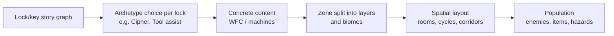

# Story graph, not dungeon layout

Navigation: [[wiki/maps/explorio-knowledge-map|Knowledge map]]

## What the generator produces

The Explorio generator outputs an abstract **progression (story) graph**: which
areas exist, which locks guard them, which keys open those locks and where the
keys can be reached. It does not place rooms, corridors, tiles or coordinates.

The project owner's stated intent (conversation, 2026-11-23): the graph is the
story structure that a later stage uses to craft a whole **biome / zone** of the
dungeon, made of a few interconnected **layers** (floors). See
[[wiki/concepts/biome-and-zone-layering|Biomes and zone layering]].

## Pipeline as it stands (dev branch)

1. Seed graph: start lock `L0` (unlocked, dungeon-wide), start access `A0`,
   main key `K0` (`main.py`).
2. Grammar rewriting: apply lock-and-key productions until 9 succeed
   ([[wiki/concepts/graph-grammar-productions|Graph grammar productions]]).
3. Environment biome injection: split the graph into two environment biomes.
4. Encounter biome injection: paint 4 encounter themes over small clusters.
5. Draw each stage with networkx + matplotlib.

The readme also names **Wave Function Collapse** as the step that turns abstract
elements into concrete types, but `machine_wfc/machines.py` is an empty dict.
See [[wiki/questions/implementation-status-and-gaps|Implementation status and gaps]].

## Pipeline the scope implies (not built)

Stages B–F are the open scope; the order is a proposal derived from the
readme and the inspirations, not a decision recorded anywhere.

## Why the distinction matters

- Validation (solvability, no soft-locks, failable paths) can run on the small
  abstract graph before any geometry exists.
- The same story graph can be laid out many ways: Dormans' *mission* graph vs
  *space* split, which Unexplored builds on (see
  [[wiki/concepts/cyclic-dungeon-generation|Cyclic dungeon generation]]).
- Unexplored 2's place / antechamber / environment model and Brogue's machines
  are candidate shapes for the later stages B–F.

## From the game design docs

- [[wiki/sources/source-gdd-06-world-generation|GDD 06]] sketches the spatial side (stage E): walkable-area methods (room
  accumulation, cellular automata, random walk, subdivision, WFC) and
  room-purpose methods (5-room dungeon, cycles, lock-and-key grammar), plus room
  types. See [[wiki/concepts/room-shape-types-and-layout-methods|Room shape types and layout methods]].
- **Generation order (decided):** the story graph comes first and is forced into a
  room map; rooms the graph does not use get standalone content ([[wiki/questions/owner-decisions|owner decision 2026-11-23]]). GDD 06's
  "lock-and-key grammar" under *room purpose classification* is this mapping step.
- **WFC (decided):** used for both geometry (GDD 06) and abstract-to-concrete
  content (dev readme) ([[wiki/questions/owner-decisions|owner decision 2026-11-23]]).
- **Support for the thesis:** the Mimic boss theme reuses one layout for two
  stacked layers with different machines ([[wiki/concepts/boss-and-race-theme-overlays|Boss and race theme overlays]]),
  which needs layout and lock/key content generated separately.
- [[wiki/sources/source-gdd-02-difficulty-balance-and-bosses|GDD 02]] adds structure above the grammar: a Five Room Dungeon template per
  biome and three acts with bosses A, B, C
  ([[wiki/concepts/five-room-dungeon-biome-template|Five Room Dungeon biome template]]).
