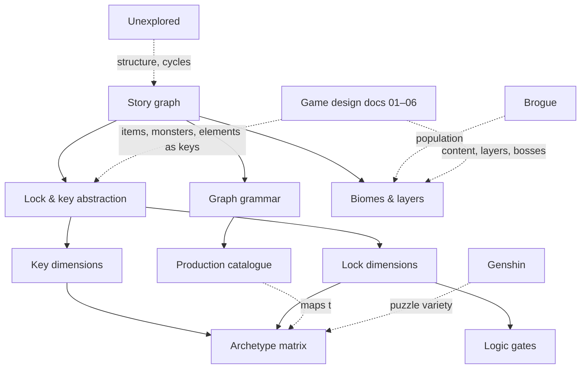

# Explorio knowledge map

Navigation: [[wiki/index|Wiki index]] · [[wiki/overview|Overview]]

Explorio is a roguelike whose dungeon generator first builds an abstract
**lock-and-key story graph** and later turns it into a zone of a few
interconnected layers. This map links everything known about that generator.

## 1. What we are building

- [[wiki/concepts/story-graph-not-dungeon-layout|Story graph, not dungeon layout]]
- [[wiki/concepts/biome-and-zone-layering|Biomes and zone layering]]

## 2. The lock-and-key model

- [[wiki/concepts/lock-and-key-abstraction|Lock and key abstraction]]
- [[wiki/concepts/key-dimensions|Key dimensions]]
- [[wiki/concepts/lock-dimensions|Lock dimensions]]
- [[wiki/concepts/lock-logic-gates|Lock logic gates]]
- [[wiki/entities/puzzle-archetype-matrix|Puzzle archetype matrix]] – 96 cells, 25 named archetypes

## 3. Generation

- [[wiki/concepts/graph-grammar-productions|Graph grammar productions]]
- [[wiki/entities/production-catalogue|Production catalogue]] – P1–P9
- [[wiki/entities/dev-branch-codebase|Dev branch codebase]]

## 4. Inspirations

- [[wiki/concepts/cyclic-dungeon-generation|Cyclic dungeon generation (Unexplored)]] – structure, cycles, key/lock properties
- [[wiki/concepts/brogue-machines-and-population|Brogue machines and population]] – content and key chains
- [[wiki/concepts/environmental-puzzle-variety|Environmental puzzle variety (Genshin Impact)]] – mechanic families

## 5. Scope and status

- [[wiki/questions/scope-and-open-questions|Scope and open questions]] – work packages and decisions needed
- [[wiki/questions/implementation-status-and-gaps|Implementation status and gaps]]
- [[wiki/questions/inconsistencies-sheet-doc-code|Inconsistencies between sheet, doc and code]]
- [[wiki/questions/owner-decisions|Owner decisions]] – what has been settled

## 6. Game design (from the GDD docs)

Structure, layers and bosses
- [[wiki/concepts/five-room-dungeon-biome-template|Five Room Dungeon biome template]]
- [[wiki/concepts/bosses-as-locks-and-gates|Bosses as locks and gates]] · [[wiki/entities/boss-and-elite-catalogue|Boss and elite catalogue]]
- [[wiki/concepts/boss-and-race-theme-overlays|Boss and race theme overlays]]
- [[wiki/concepts/room-shape-types-and-layout-methods|Room shape types and layout methods]]
- [[wiki/entities/biome-catalogue-with-generation-hints|Biome catalogue with generation hints]]
- [[wiki/concepts/difficulty-scaling-across-depth|Difficulty scaling across depth]] · [[wiki/concepts/backtracking-mitigation|Backtracking mitigation]]

Keys and locks in content
- [[wiki/concepts/items-as-keys|Items as keys]] · [[wiki/entities/item-catalogue|Item catalogue]] · [[wiki/entities/cursed-and-unique-items|Cursed and unique items]]
- [[wiki/concepts/player-verbs-and-abilities-as-keys|Player verbs and abilities as keys]] · [[wiki/entities/character-classes-and-starting-kits|Character classes and starting kits]]
- [[wiki/concepts/monsters-as-keys-and-locks|Monsters as keys and locks]] · [[wiki/concepts/enemy-lure-and-deterrence|Enemy lure and deterrence]]
- [[wiki/entities/bestiary-monster-families|Bestiary monster families]] · [[wiki/entities/monster-encounter-biome-affinity|Monster encounter and biome affinity]]
- [[wiki/concepts/elemental-status-interactions-as-locks-and-keys|Elemental status interactions]] · [[wiki/entities/status-effect-catalogue|Status effect catalogue]]
- [[wiki/concepts/spellcasting-as-limited-key-resource|Spellcasting as a limited key resource]] · [[wiki/concepts/damage-over-time-and-health-indicators|Damage over time and health indicators]]
- [[wiki/concepts/key-burden-and-compound-puzzles|Key burden and compound puzzles]] · [[wiki/concepts/trap-puzzle-and-encounter-intent-taxonomy|Trap, puzzle and encounter intent taxonomy]]
- [[wiki/entities/environmental-hazard-and-container-catalogue|Environmental hazard and container catalogue]]

Runs, seeds and progression
- [[wiki/concepts/run-structure-seeds-and-biome-tiers|Run structure, seeds and biome tiers]] · [[wiki/concepts/seed-save-and-run-reproducibility|Seed save and run reproducibility]]
- [[wiki/concepts/meta-progression-and-unlocks|Meta progression and unlocks]]
- [[wiki/concepts/elements-pantheons-and-seed-campaign-arc|Elements, pantheons and seed campaign arc]]
- [[wiki/entities/reference-games-and-borrowed-features|Reference games and borrowed features]] · [[wiki/entities/noita-style-staff-enhancement-ideas|Noita-style staff enhancement ideas]]

## Sources

- [[wiki/sources/source-product-sheet-key-lock-matrix|Explorio Product Sheet]]
- [[wiki/sources/source-dev-productions-doc|Productions doc]]
- [[wiki/sources/source-dev-code-snapshot|Dev code snapshot]]
- [[wiki/sources/source-inspiration-web-research|Inspiration web research]]
- [[wiki/sources/source-gdd-01-bestiary|GDD 01]] – Bestiary
- [[wiki/sources/source-gdd-02-difficulty-balance-and-bosses|GDD 02]] – Difficulty Balance and Bosses
- [[wiki/sources/source-gdd-03-items-compendium|GDD 03]] – Items Compendium
- [[wiki/sources/source-gdd-04-magic-and-statuses-overview|GDD 04]] – Magic and Statuses Overview
- [[wiki/sources/source-gdd-05-gameplay-and-progression-systems|GDD 05]] – Gameplay and Progression Systems
- [[wiki/sources/source-gdd-06-world-generation|GDD 06]] – World Generation
- [[wiki/sources/source-gdd-0x-misc-ideas|GDD 0x]] – Misc Ideas
