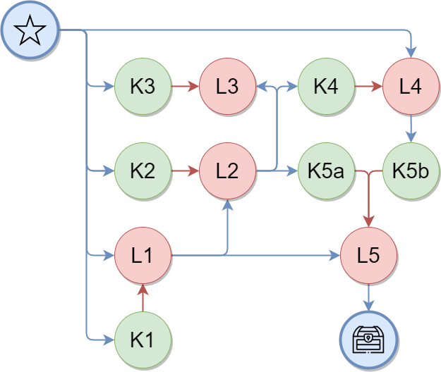

# Generation and visualization of the Explorio Dungeon logical layout

This is a PoC for the dungeon generation system for the Explorio game.
Main methodology used is Lock and Key system implemented with Graph grammars as well as Wave Function Collapse to specify concrete types of abstract elements.

## Working with the repo

### Create virtual environment

-   `python -m pip install venv`
-   `python -m venv env`

#### Windows

-   `env/Scripts/activate.ps1` for powershell
-   `env/Scripts/activate.bat` for cmd

#### Linux

-   `source env/bin/activate` in bash

### Install required packages

-   `python -m pip install -r requirements.txt`

### Run the example script to validate the environment

-   `python main.py` – random seed, printed at the start
-   `python main.py --seed 42` – the same seed gives the same graph
-   `python main.py --seed 42 --steps 15 --no-plot` – more productions, no plot windows

### Interactive GUI

-   `python gui.py` – starts a local server on http://127.0.0.1:8765/ and opens it in the browser
    (`--port` to change the port, `--no-browser` to only start the server)
-   Seed, number of productions, production weights and biome passes in the sidebar; the parameters are kept
    in the URL, so a link reopens the same graph
-   Step through the generation with the timeline (keys: ← → Home End, Space plays), hover any node or edge
    for its attributes, export the final graph as JSON (`explorio.story-graph.v1`, see `story_export.py`)
    or the current step as PNG or SVG
-   Browser check: with the GUI server running, `node tools/gui-browser-check.cjs` (needs Playwright; set
    `PLAYWRIGHT_MODULE` to a playwright package directory if it isn't installed where Node finds it)

### Archetype data

-   `data/archetypes.yaml` holds one abstract puzzle archetype per lock/key combination (96); `archetypes.py`
    loads and validates it when the generator starts, and every generated lock carries its archetype id
-   `tools/import_archetype_sheet.py` seeded the file from the product sheet CSV; the file is edited by hand
    since, so the script refuses to overwrite it without `--force`

### Run the tests

-   `python -m pytest`
